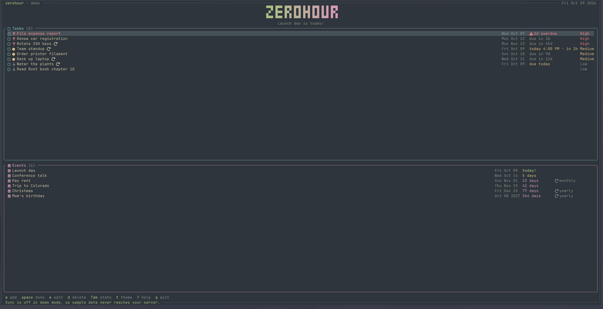
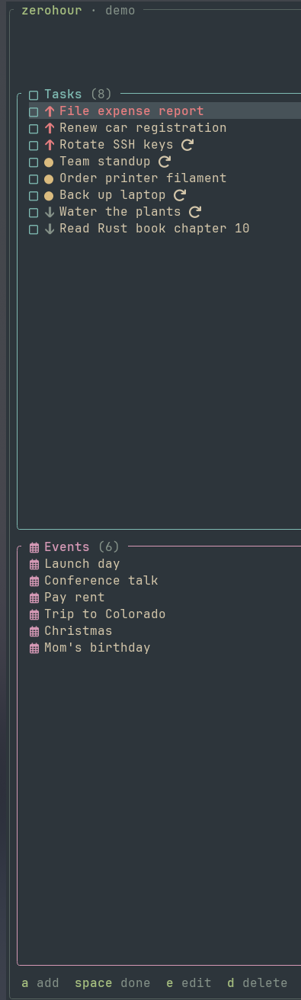
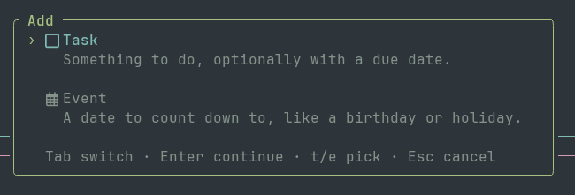
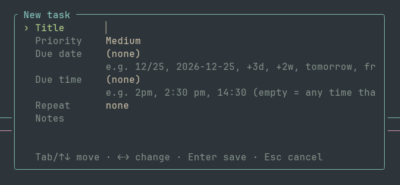
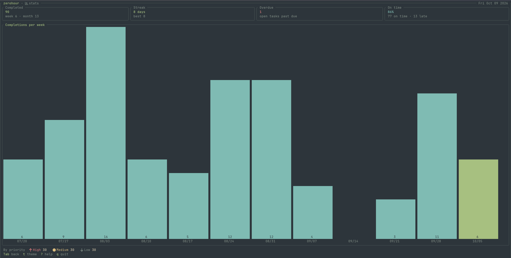
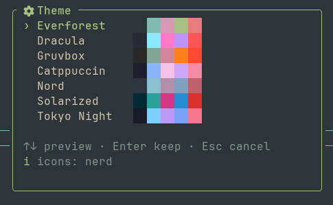

# zerohour

A terminal to-do list with built-in countdowns, written in Rust with [Ratatui](https://ratatui.rs).

Track **tasks** (things to do) and **events** (dates to count down to) in one clean, themeable TUI.
Add Christmas once and it counts down every year: after the date passes, it rolls over to the next one automatically.



*The main screen (demo data): the title banner with a countdown to the next event, tasks on top with an overdue one in red and one due at 4:00 PM, and upcoming events below.*

> **Status:** early development.

## Features

- **Tasks and events in one view.** Tasks on top, events underneath, each with its own color and icon.
- **Countdowns that repeat.** Yearly, monthly, weekly, daily, every N days/weeks/months, or on chosen weekdays (weekdays, Mon–Thu, or any days you pick).
- **Repeating tasks.** Completing one creates the next instance with the next due date.
- **Due times.** Give a task a time ("2pm") and it shows "today 2:00 PM · in 3h", turning overdue the minute it passes. 12- or 24-hour clock.
- **Calendar picker** for dates (Ctrl+D or F2), with the keyboard or a mouse click. Typing dates still works.
- **Priorities and notes** on every item.
- **Statistics.** Completions per week, streaks, overdue count, and more, with a bar chart.
- **Themes.** Everforest, Dracula, Gruvbox, Catppuccin, Nord, Solarized, Tokyo Night, with a live-preview picker.
- **Nerd Font icons** with Unicode and ASCII fallbacks.
- **Title banner.** A big "zerohour" in the theme's colors with a countdown to your next event, on terminals 30+ rows tall (`b` hides it).
- **Narrow mode** for small terminal windows, and a 50/50 or fit-to-content layout for the Tasks and Events boxes.
- **Local-first.** Your data lives in a single SQLite file on your machine.
- **Optional sync** between devices through your own CouchDB server. Off by default, and left out of the build unless you ask for it.

## Screenshots



*Tasks and events each get their own section, color, and marker; repeating items show a ↻.*



*Adding something starts with one choice: a task or an event.*



*The new-task form, with hints for the dates and times you can type.*



*Statistics: completed tasks, current streak, overdue count, on-time rate, and completions per week.*



*The theme picker previews each theme live as you move through the list.*

## Install

Requires a recent [Rust toolchain](https://rustup.rs).

```sh
git clone https://github.com/shanecuster/zerohour.git
cd zerohour
cargo install --path tui
```

Then run:

```sh
zerohour
```

To include the optional [sync](#sync-optional) feature, install with:

```sh
cargo install --path tui --features sync
```

Without `--features sync`, the app contains no network code at all.

Try it with sample data (nothing is saved):

```sh
zerohour --demo
```

For the best look, set your terminal to a **Nerd Font Mono** font (for example, "JetBrainsMono Nerd Font Mono").
Without one, press `i` in the app to switch to Unicode or ASCII icons.

## Usage

Press `?` inside the app for the full list of keybindings. The basics:

| Key | Action |
|---|---|
| `a` | Add a task or event |
| `Space` / `x` | Complete a task |
| `e` / `Enter` | Edit the selected item |
| `d` | Delete the selected item |
| `j` / `k` or arrows | Move up and down |
| `g` / `G` | Jump to top / bottom |
| `p` | Show or hide passed events |
| `v` | Layout: split 50/50, or Events fit their content |
| `T` | Times: 12-hour or 24-hour |
| `b` | Title banner on or off (shows on terminals 30+ rows tall, not in narrow mode) |
| `Tab` / `s` | Switch to the stats screen |
| `t` | Pick a theme |
| `i` | Cycle icon mode (Nerd Font / Unicode / ASCII) |
| `?` | Help |
| `q` | Quit |
| `r` | Sync now (sync builds only) |
| `c` | Sync settings (sync builds only) |

In the add/edit dialog:

| Key | Action |
|---|---|
| `Tab` / `↑` `↓` | Move between fields |
| `←` `→` | Change a choice (priority, repeat); move between days in the day checkboxes |
| `Space` | Toggle a checkbox or a day |
| `Ctrl+D` / `F2` | Open the calendar on the date field |
| `Enter` | Save |
| `Esc` | Close (or close just the calendar) |

In the calendar: arrows or `h` `j` `k` `l` move by day/week, `PgUp` / `PgDn` by month, `t` jumps to today,
`w` switches the first day of the week (Sunday or Monday), `Enter` picks, `Esc` closes.
A mouse click on a day picks it, and the scroll wheel changes the month.

### Due times and weekday repeats

- A **due time** is optional and needs a due date. Type `2pm`, `2:30 pm`, `14:30`, or `noon`.
  It's stored as local wall-clock time, so 2 PM means 2 PM wherever you are (also on a synced device in another time zone).
  A task with a time is overdue once that time passes; without one, the whole day counts as on time.
- **Repeat on weekdays**: choose *weekdays*, *Mon–Thu*, or *pick days* and tick the days you want.
  A start date that isn't one of those days moves forward to the next one when you save (the dialog tells you), and an empty date is filled in.
- When you complete a repeating task, the next one is due at the **first scheduled time after both its old due time and now**.
  A Mon–Thu 2 PM task completed on Thursday is next due Monday at 2 PM.
  Done late? Missed days are not added; you get the next upcoming one (still today, if today's time hasn't passed yet).

Options:

- `--db <path>`: use a different database file
- `--demo`: load sample data without saving anything

Your data is stored in `~/.local/share/zerohour/zerohour.db`.

**Upgrading:** new versions update the database automatically and keep your data.
Going back is limited: once you've used a weekday repeat, an older version of zerohour can't open that database
(it reports "bad data" instead of guessing). Keep a copy of the file before upgrading if you might go back.

## Sync (optional)

zerohour can keep several devices in sync through a [CouchDB](https://couchdb.apache.org) server that you run yourself.
Sync is **off by default**. Until you switch it on, the app never touches the network.

### Before you start

- **Your data is stored unencrypted on the server.** Each task, event, and completion is a plain JSON document.
  Anyone with admin access to the server, or to its disk or backups, can read them.
  Use a server you control, reach it over `https://` or a private network such as Tailscale, and use a separate database and user just for zerohour.
- **Start every additional device with an empty database.** Sync merges everything, and every item has a unique ID.
  If two devices both already contain "Christmas", you will end up with two of them.
  Set up sync on a new device *before* adding anything there, and it simply downloads everything.
- **Keep device clocks correct** (enable NTP / automatic time). When the same item is changed on two devices,
  the newest change wins, so a clock that runs fast wins conflicts it shouldn't. zerohour warns you if your clock
  is more than a minute off from the server's.

### Server setup (once)

zerohour never creates or deletes databases. Create one database and one user for it, for example with `curl`
(`-u admin` asks for the admin password, so it stays out of your shell history; Fauxton, CouchDB's web UI, works too):

```sh
# The database
curl -u admin -X PUT https://couchdb.example.ts.net/zerohour

# A user just for zerohour (pick your own password; this one is a placeholder)
curl -u admin -X PUT https://couchdb.example.ts.net/_users/org.couchdb.user:zerohour-sync \
     -H 'Content-Type: application/json' \
     -d '{"name": "zerohour-sync", "password": "CHANGE-ME", "roles": [], "type": "user"}'

# Only that user may read and write the database
curl -u admin -X PUT https://couchdb.example.ts.net/zerohour/_security \
     -H 'Content-Type: application/json' \
     -d '{"admins": {"names": [], "roles": []}, "members": {"names": ["zerohour-sync"], "roles": []}}'
```

### Turning it on

1. Press `c` to open the sync settings.
2. Fill in the server URL (e.g. `https://couchdb.example.ts.net`), database name, username, and password.
3. Choose **Test connection**, then switch **Sync** on and choose **Save**. The first sync starts right away.

After that, zerohour syncs in the background when it starts, and whenever you press `r`.
The header shows the status: *never synced*, *syncing…*, *synced 14:03*, *offline*, or *sync error*.
A failed or offline sync never blocks the app; your data stays on your device and syncs next time.

`http://` URLs work, but zerohour warns you: the password and your data travel unencrypted unless the network
itself is encrypted (Tailscale, WireGuard, a VPN).

### How conflicts are resolved

- The newest change to an item wins.
- A deletion always sticks, even if another device edited the item later.
- A completed task stays completed, even if another device edited it later.
- Completing the same repeating task on two offline devices creates one next instance, not two.

Items with a due time or a weekday repeat are stored on the server in a newer format (`v: 2`).
A device running an older zerohour skips just those items and shows "update zerohour"; everything else keeps syncing.
Update every device to use these features everywhere.

### Where the password is kept

Never in the database file. zerohour uses your OS keyring (Secret Service / GNOME Keyring / KWallet on Linux,
Keychain on macOS, Credential Manager on Windows). If no keyring is available, for example on a headless machine,
it uses `~/.config/zerohour/sync-password`, a plain-text file readable only by you (`0600`).
The settings screen shows which one is in use.

### Starting over

**Reset sync state** in the settings forgets which versions the server has. Your data isn't touched.
The next sync compares everything again, without creating duplicates. Changing the server URL or database name does this automatically.

## Project layout

- `core/`: all the logic (data model, repeat and countdown math, storage, stats, themes, icons, and the optional sync in `core/src/sync/`). It has no terminal code, so it can be reused by other front ends.
- `tui/`: the Ratatui terminal interface.

## Roadmap

- [x] Core logic and terminal UI
- [x] Optional sync between devices (self-hosted CouchDB)
- [ ] Native Android app sharing the same Rust core
- [ ] Notifications and reminders

## Development

```sh
cargo test
cargo clippy --all-targets -- -D warnings
cargo fmt --check

# The same with sync compiled in
cargo test --features sync
cargo clippy --all-targets --features sync -- -D warnings
```

The sync tests use an in-memory fake CouchDB, so no server is needed. See [CHANGELOG.md](CHANGELOG.md) for what changed.

## License

MIT. See [LICENSE](LICENSE).
